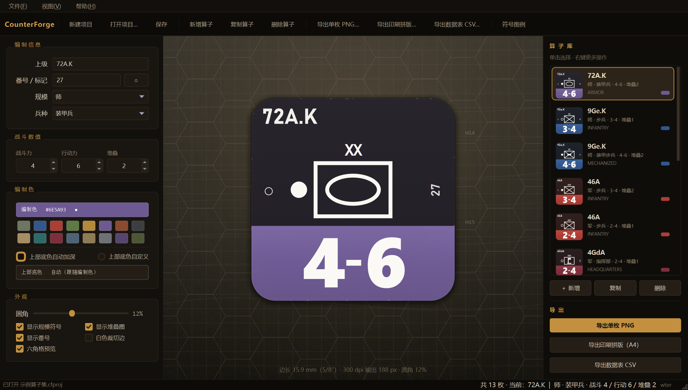
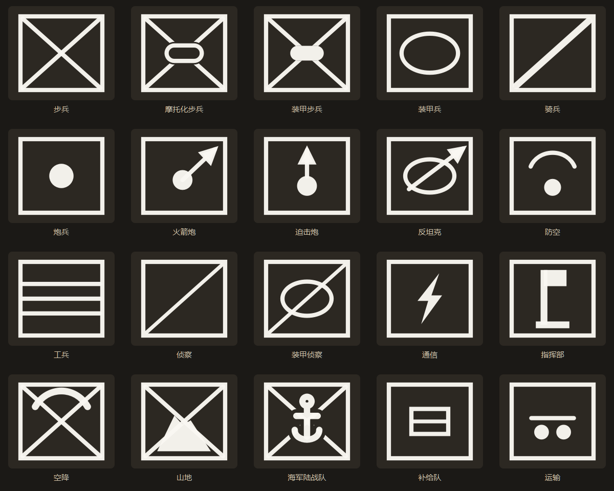
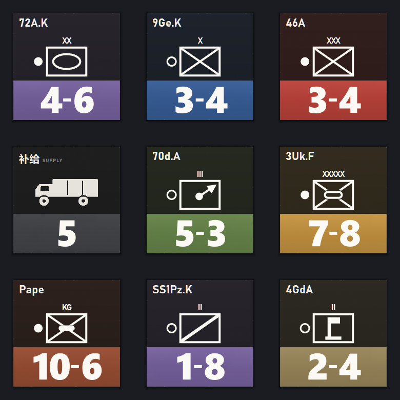
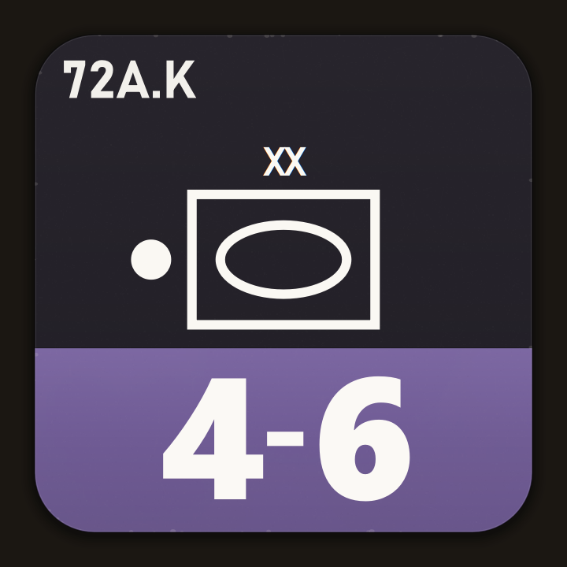
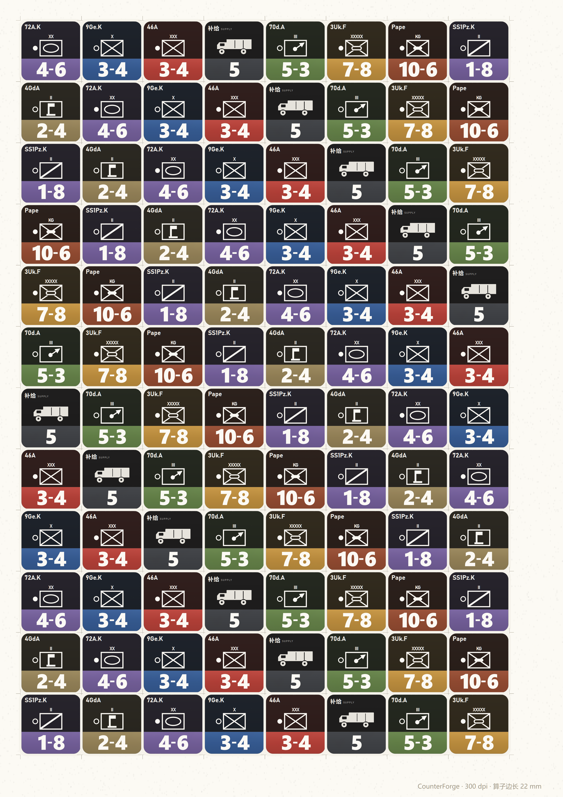
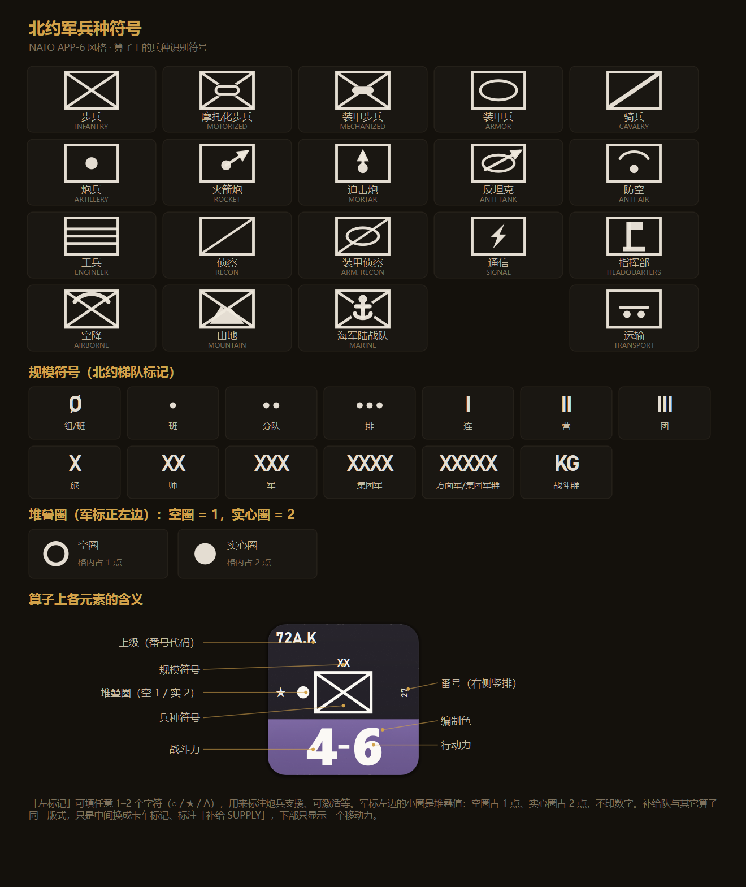

# CounterForge

面向兵棋（wargame）推演的**算子在制设计器**。纯 C++ / Qt6 绘制，一枚算子从参数到印刷成品只需几步。

作者：**wter**

版面参照国内成品兵棋（千伏工作室《帝国反击》）的算子做法：**上部近黑深色区放编号与图形，下部整条编制色彩带放数值**。上部底色统一压到接近黑，编制色只出现在下部彩带——这样一摞算子摊在桌上时，颜色是整齐的一条条色带，而不是一堆各不相同的色块。算子外框是**正方形**（默认 12% 圆角，可调到直角或更圆）；数字用 Segoe UI Black 按目标宽高比自动缩放、顶格排布，是整枚算子最抢眼的部分。



---

## 一、下载与运行

**直接下载**：[CounterForge v1.0.0 · Windows x64](https://github.com/wter-28/CounterForge/releases/latest)（内含 Qt 6 运行库，解压即用，无需安装 Qt）。

源码构建后同样可以直接运行：

```
dist/CounterForge.exe
```

- 双击 `dist/samples/示例算子集.cfproj` 可载入 13 枚示例算子（含装甲、步兵、炮兵、补给等）。
- 也可以把 `.cfproj` 文件直接拖到 `CounterForge.exe` 上打开。

## 二、功能

**算子属性（全部可自定义）**

| 属性 | 说明 |
| --- | --- |
| 上级 | 算子顶部文字，如 `72A.K` / `46A`（左上角，自动按宽度缩放字号） |
| 规模 | 北约梯队符号：组/班 Ø、班 ·、分队 ··、排 ···、连 I、营 II、团 III、旅 X、师 XX、军 XXX、集团军 XXXX、方面军 XXXXX、战斗群 KG |
| 兵种 | 北约 APP-6 风格符号，共 20 种：步兵、摩托化步兵、装甲步兵、装甲兵、骑兵、炮兵、火箭炮、迫击炮、反坦克、防空、工兵、侦察、装甲侦察、通信、指挥部、空降、山地、海军陆战队、补给队、运输 |
| 番号 | 可选，右侧**竖排**小字（成品算子的常见做法，如 `27` / `189`） |
| 左标记 | 可选，算子左侧 1–2 个字符（`○` / `★` / `空`），用于标注炮兵支援、可激活等功能 |
| 堆叠值 | 只有两级，印成**军标正左边的小圈**：**空圈 = 占 1 点**、**实心圈 = 占 2 点**，不印数字（可关） |
| 战斗力 / 行动力 | 0–99，下部彩色带以 `战斗力-行动力` 排版 |
| 编制色 | 16 色预设（原野灰、钢蓝、砖红、橄榄、赭黄、紫、铁锈、石墨、沙褐、深青、酒红、蓝灰、卡其、烟灰、暗紫、暗橄榄）+ 任意取色；上部深色底默认自动压暗，也可手选 |

**版面结构**

```
┌──────────────────────────┐
│ 72A.K                    │  上级编号（左上）
│            XX            │  规模符号（可关）
│   ┌──────────────────┐   │
│ ● │                  │   │  堆叠圈（军标左侧：空 1 / 实 2）
│   │      [ 符号 ]     │   │  北约兵种符号（居中，白线）
│   └──────────────────┘   │
│  ○                   27 │  左标记 · 右侧竖排番号
├──────────────────────────┤
│        4 - 6             │  编制色彩带：战斗力 - 行动力
└──────────────────────────┘
```

中心图形统一用**北约制式兵种符号**——它是标准语言，任何一枚算子放在一起都能立刻读懂，也不会像车辆剪影那样在 15 mm 的实际尺寸上糊成一团。补给队与其它算子同一版式，只是中间换成卡车图形，下部只印一个移动力。卡车有**三种画法**（属性面板暂未开放，先用命令行自检预览）：

| 样式 | 说明 |
| --- | --- |
| `A` 实心卡车 | 默认。实心平涂的长头厢式货车，15 mm 实际尺寸下辨识度最高 |
| `B` 线稿卡车 | 等宽白线，笔触与北约军标一致，桌面预览更秀气 |
| `C` 北约补给符号 | 直接用 APP-6 的补给符号（板条箱），与其它算子完全同构 |

预览命令：`CounterForge.exe --supoptions 输出.png`（渲染三种样式的对照图）。

所有符号按同一套几何规则重绘：外框直角、笔画粗细统一（框宽的 5.2%）、修饰符（摩托化/机械化的胶囊、空降的翼、山地的山脊、海陆的锚）会**把交叉线挖开**，不会再和 X 糊成一坨。



**印刷质感**

- 极轻的纸纹与油墨不匀：看得出是印上去的，但不做旧、不掉渣
- 彩带为哑光渐变，与上部深色区之间是一条硬边分界（不是发光高光）
- 模切边：正方形外框，**默认 12% 圆角**（0–30% 可调，0 即直角）+ 一条干净的暗线 + 内侧极淡纸白
- 投影四边等量扩散（只在正下方偏移 0.6%），保证含投影的轮廓仍是 1:1；旧版下方偏移 5%、上方 0，会把方块看成竖长方形
- 所有符号为矢量绘制，任意倍率不失真；纹理程序化生成，无外部图片依赖

**其它可调项**

- 圆角 0–30%（默认 12%）、白色裁切边、是否显示规模符号 / 堆叠圈 / 番号
- 预览区可显示六角格背景，便于核对与地图的比例关系

**算子库与输出**

- 左侧编辑、中间实时预览、右侧算子库；支持新增 / 复制 / 删除 / 上移 / 下移（右键菜单）
- 项目保存为 `.cfproj`（JSON 文本，可手改、可进版本库）
- 导出单枚 PNG（自定边长，最高 2400 px，透明底或白边）
- 导出 A4 印刷拼版（150 / 300 / 600 dpi，可调算子边长、裁切标记、名称标注，自动重复排满整页）
- 导出 CSV 数据表（UTF-8 BOM，Excel 直接打开）



单枚放大效果（`docs/单枚样张.png`）：



## 三、快捷键

| 操作 | 快捷键 |
| --- | --- |
| 新增算子 | `Ctrl+N` |
| 复制算子 | `Ctrl+D` |
| 删除算子 | `Delete` |
| 新建项目 | `Ctrl+Shift+N` |
| 打开项目 | `Ctrl+O` |
| 保存 / 另存为 | `Ctrl+S` / `Ctrl+Shift+S` |
| 导出单枚 PNG | `Ctrl+E` |
| 导出印刷拼版 | `Ctrl+Shift+E` |
| 符号图例 | `F1` |

## 四、从源码编译

依赖：Qt 6.4+（含 Widgets）、CMake 3.21+、MinGW 或 MSVC。

```bat
build.bat
```

`build.bat` 默认使用本机的 `D:\QT\6.10.2\mingw_64` + `D:\QT\Tools\mingw1310_64`，如环境不同请修改文件开头三个变量。也可手动：

```bat
cmake -S . -B build -G Ninja -DCMAKE_BUILD_TYPE=Release -DCMAKE_PREFIX_PATH=D:/QT/6.10.2/mingw_64
cmake --build build
```

产物体积小、无外部资源依赖：所有符号与图标均为代码矢量绘制（QSS 需要的几个小箭头在启动时生成到临时目录）。

## 五、输出规格

- 算子画布按 1000×1000 逻辑单位绘制，任意尺寸下均无锯齿
- 标准兵棋尺寸 15.9 mm（5/8 英寸）在 300 dpi 下为 188 px；导出时可选更高分辨率
- A4 拼版默认 22 mm 算子、0.8 mm 间隙，四周留 8 mm 页边，角部带 1.6 mm 裁切标记与白色出血边



## 六、符号约定

见程序内 `F1` 图例，或 `docs/符号图例.png`。要点：

- 兵种符号采用 APP-6 风格外框 + 内部图元；摩托化步兵为「步兵框 + 扁椭圆（轮式）」，装甲步兵为「步兵框 + 实心椭圆（装甲）」，可与装甲兵的单一椭圆区分。
- 骑兵与侦察都用单斜杠，靠**线重**区分：骑兵 1.55×框线，侦察 0.85×框线（装甲侦察同理）。斜杠两端圆头内缩半个线宽、正好切于内框直角，不会像旧版那样鼓出角外糊成一坨。
- 规模用标准北约梯队标记（I/II/III/X/XX/XXX/XXXX/XXXXX，班组用圆点、组用 Ø、战斗群用 KG）；堆叠值只有两级，印成军标正左边的小圈（与符号中线对齐）：**空圈＝占 1 点，实心圈＝占 2 点**，不印数字（实心圈直径取空圈的中线，实心不会显得比空圈更大）。
- 补给队为特殊版式：顶部「补给 SUPPLY」，无兵种框与规模符号，下部只显示移动力。



## 七、目录结构

```
CounterForge/
├─ src/
│  ├─ main.cpp              程序入口、深色主题、自检渲染入口
│  ├─ counterspec.h/.cpp    算子数据模型、枚举与 JSON 序列化
│  ├─ counterrenderer.h/.cpp 绘制引擎（版面、北约符号、规模、数值、拼版）
│  ├─ widgets.h/.cpp        预览画布、算子库列表委托
│  ├─ legenddialog.h/.cpp   符号图例
│  └─ mainwindow.h/.cpp     主界面、项目管理、导出
├─ dist/                    已打包的可运行程序 + 示例项目
├─ docs/                    截图与输出示例
├─ CMakeLists.txt
└─ build.bat
```

## 八、自检（开发用）

```bat
CounterForge.exe --selftest out.png      :: 九枚样例算子拼图
CounterForge.exe --sheet out.png         :: A4 拼版
CounterForge.exe --legend out.png        :: 符号图例
CounterForge.exe --shot out.png          :: 主界面截图
CounterForge.exe project.cfproj --shot out.png
```

---

作者 **wter** · 用 Qt 6 / C++ 写的桌面小工具，欢迎提 issue 与 PR。
